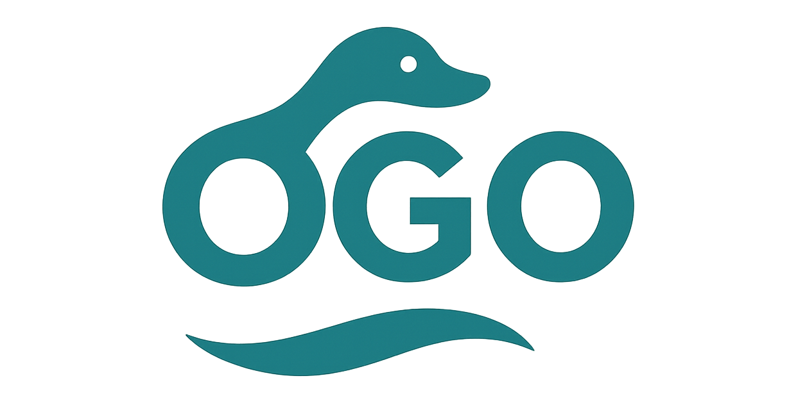

Ogo
===
Like the `Ogopogo of the Okanagan`_, osteoporosis is elusive.
Help build a fracture free future.

============= ============
     Docs        Tests    
============= ============
|ReadTheDocs|  |Azure| 
============= ============

.. _Ogopogo of the Okanagan: https://youtu.be/aOgKuMV76KM

.. |ReadTheDocs| image:: https://readthedocs.org/projects/ogo/badge/?version=latest
    :target: http://ogo.readthedocs.io/en/latest/?badge=latest
    :alt: Documentation Status

.. |Azure| image:: https://github.com/Bonelab/Ogo/actions/workflows/main.yml/badge.svg
    :target: https://github.com/Bonelab/Ogo/actions/workflows/main.yml/badge.svg
    :alt: Tests Status

Overview
========

This repository contains command-line applications developed for performing bone health analysis from computed tomography images.

It includes tools for segmentation, calibration, image manipulation, segmentation validation
and quantitative analysis. It is expected that the data format is NIfTI, so DICOM files should
be converted using a trusted tool (we recommend https://github.com/dgobbi/vtk-dicom). It is 
also helpful to integrate this with the free finite element analysis FAIM tool, developed
in the Bone Imaging Laboratory (https://bonelab.github.io/n88/faim.html).

A key function of Ogo is quantitative calibration of CT data, including internal calibration,
which was presented at the ASBMR in 2018 and published in 2020:

- Michalski AS, Besler BA, Michalak GJ, Boyd SK, 2018 Feasibility of QCT internal density calibration for site-specific osteoporosis assessment. In American Society of Bone and Mineral Research Annual Meeting. Montreal, Canada. September 28 - October 1, 2018.
- Michalski AS, Besler BA, Michalak GJ, Boyd SK, 2020 CT-based internal density calibration for opportunistic skeletal assessment using abdominal CT scans. Med Eng Phys 78, 55-63. doi = 10.1016/j.medengphy.2020.01.009 url = https://www.ncbi.nlm.nih.gov/pubmed/32059948.

For further information about the Bone Imaging Laboratory see https://bonelab.ucalgary.ca. 
Please contact us for further questions, comments or interest in contributing to this project.

Finite Element Modelling
========================

For hip and spine models, start with the `FEA run guide <ogo/fea/README.md>`_.
The `vertebra quickstart <docs/fea/vertebra_fea_quickstart.md>`_ covers installation
and a first L1 model; the `code map <docs/fea/implementation.md>`_ locates the
registration, material laws, supports and QC functions.

Install
=======

Create a Conda environment called ``ogo``, activate it, and install Ogo:

.. code-block:: bash

    # Clone the repository onto your computer and change into the directory.
    # ... with SSH authentication
    git clone git@github.com:Bonelab/Ogo.git
    # ... or straight HTTPS
    git clone https://github.com/Bonelab/Ogo.git
    cd Ogo

    # Create a virtual environment using the provided environment.yml file. This will install all dependencies.
    conda env create --file environment.yml
    
    # Activate your conda environment, make sure you have conda installed on your system.
    conda activate ogo
    
    # Install in an 'editable' format 
    python -m pip install -e .

The environment file selects Python 3.12 and the compatible VTK/vtkbone stack.
GraphCuts executables and FEA solver tools require their own installation.

Modernization pilot
===================

The ``ogo-modernization`` branch currently installs only ``ogo``, with three
migrated subcommands: ``print-labels``, ``check-labels``, and ``resample-image``.

From the modernization checkout, use a separate pilot environment:

.. code-block:: bash

    conda env create --name ogo-pilot --file environment.yml
    conda activate ogo-pilot
    python -m pip install -e .

Then inspect the catalog, print a table, or check segmentation labels:

.. code-block:: bash

    ogo --help
    ogo --version
    ogo print-labels --help
    ogo print-labels > ogo-master-labels.txt
    ogo print-labels --echo colors16
    ogo check-labels segmentation.nii.gz
    ogo check-labels segmentation.nii.gz --require 2 10 --include-description
    ogo --quiet check-labels segmentation.nii.gz > labels.txt

Resample a 3D CT image or segmentation with explicit output permission:

.. code-block:: bash

    ogo resample-image input.nii.gz output.nii.gz --iso-resolution 1.0 --image-type ct
    ogo resample-image mask.nii.gz resized-mask.nii.gz --image-type mask --overwrite

The operations can also be called from Python without ending the process. They
raise errors to the caller, resampling emits standard logging diagnostics:

.. code-block:: python

    from ogo.cli.PrintLabels import render_labels
    from ogo.cli.CheckLabels import read_labels, find_missing_labels

    table = render_labels("labels")
    present = read_labels("segmentation.nii.gz")
    missing = find_missing_labels(present, [2, 10])

    from ogo.cli.IsotropicResampling import resample_image_file

    output = resample_image_file("input.nii.gz", "output.nii.gz", image_type="ct")

Development checks
==================

To run the automated checks in the activated environment:

.. code-block:: bash

    python -m pip install "pytest>=7,<10"
    python -m pytest tests -m "not integration" -ra

Integration tests require external study data or solver resources and are run
separately with those inputs. Install Sphinx only when building the documentation.

Utilities
=========

ogo.util
----------

:code:`ogo.util.echo_arguments`

- utility function to use with a command-line application, or a function, to automatically print the arguments to the terminal

:code:`ogo.util.Helper`

- numerous helper functions for tasks in the command line functions (many of these are legacy and not used anymore)

:code:`ogo.util.write_csv`

- utility function for writing data stored in a dictionary to a csv file

:code:`ogo.util.graphcuts`

- place holder for installing software for ogoGraphCuts. Read OGO_GRAPHCUTS_INSTALL.txt

ogo.dat
----------

:code:`ogo.dat.OgoMasterLabels`

- a dictionary of labels used by many of the command line interface functions. Any new labels must be defined here. Use ``ogo print-labels`` to output the dictionary in the pilot.

:code:`ogo.dat.MassAttenuationTables`

- the NIST table of mass attenuation versus energy levels used for internal calibration.

:code:`ogo.dat.RT_FEMUR_SIDEWAYS_FALL_REF`

- the reference polygon data for alignment prior to finite element analysis.

:code:`ogo.dat.LT_FEMUR_SIDEWAYS_FALL_REF`

- the reference polygon data for alignment prior to finite element analysis.

:code:`ogo.dat.L4_BODY_SPINE_COMPRESSION_REF`

- the reference polygon data for alignment prior to finite element analysis.

ogo.calib
----------

The calibration functionality is templated as described below and is best accessed using CLI :code:`ogoImageCalibration`

:code:`ogo.calib.calibration`

- top class for all types of calibration

:code:`ogo.calib.standard_calibration`

- inherits from :code:`calibration` and implements basic commands

:code:`ogo.calib.internal_calibration`

- function for performing internal calibration; inherits from :code:`standard_calibration` and :code:`calibration`

:code:`ogo.calib.mindways_calibration`

- function for performing phantom calibration; inherits from :code:`standard_calibration` and :code:`calibration`

Command Line Apps
=================

The pilot exposes ``ogo print-labels``, ``ogo check-labels``, and
``ogo resample-image``, described above.
The table below lists historical commands for reference to the baseline installation. It is not
the pilot's installed command catalog. To inspect the current catalog, run
``ogo --help``; use ``ogo <command> --help`` for a migrated command.

.. list-table::
   :widths: 25 100
   :header-rows: 1

   * - Command
     - Description
   * - :code:`ogoAnalyzeBMD`
     - measure bone mineral density for each label provided from a calibrated CT scan
   * - :code:`ogoCreateDatasetJSON`
     - generates JSON for defining raw CT, labelled CT, and unlabelled CT for machine learning (nnUNet)
   * - :code:`ogoFEA`
     - prepares hip/spine finite-element models and attempts solving by default; use --no-solve for generation only
   * - :code:`ogoValidateFEA`
     - validates and reviews FEA models and quality-control outputs
   * - :code:`ogoGraphCuts`
     - wrapper for using GraphCuts and requires user to install compiled software (see ogo.util)
   * - :code:`ogoImageCalibration`
     - perform internal calibration of phantom calibration
   * - :code:`ogoImageCrop`
     - utility to crop an image
   * - :code:`ogoImageExam`
     - utility to examine the header, histogram and dimensions of a NIfTI image
   * - :code:`ogoImageIntensityWindowingFilter`
     - applies a linear scale to the intensity levels of a NIfTI image
   * - :code:`ogoImageThreshold`
     - utility threshold a NIfTI image
   * - :code:`ogoIntensityProjection`
     - create a 2D projection of 3D computed tomography data
   * - :code:`ogoIsotropicResampling`
     - resample a 3D computed tomography datasets to new dimensions
   * - :code:`ogoMergeLabels`
     - combine labels from multiple images into a single image; useful for working with TotalSegmentator
   * - :code:`ogoMorphologicalOperation`
     - performs dilate, erode, opening, closing on labels
   * - :code:`ogoPrintLabels`
     - output the labels used for bones and other tissues
   * - :code:`ogoProcrustes`
     - determine whether two datasets have similar bone anatomy as per Procrustes
   * - :code:`ogoRepairNIfTI`
     - fix instances of corrupted NIfTI files
   * - :code:`ogoReplaceLabels`
     - replace labels in an image with a new label or erase a label
   * - :code:`ogoValidate`
     - can validate accuracy of labels from machine learning and has basic repair functions
   * - :code:`ogoValidateSummary`
     - provides a summary of validation results from ogoValidate
   * - :code:`ogoValidateSelectBest`
     - a utility to identify best validation from multiple results output from ogoValidate
   * - :code:`ogoVisualize`
     - interactive visualization tool or offscreen rendering in 2D or 3D
   * - :code:`ogodcm2nii`
     - convert DICOM files to NIfTI images (deprecated)
   * - :code: `ogoCheckLabels`
      - utility to check the labels present in an image, or to check that required labels are present in an image 
	 
	 
Additional Resources
=================
Segmentation: 

- Pretrained nnU-Net model for 3D segmentation of CT reference tissues for phantomless calibration: https://zenodo.org/records/15238423. This model segments adipose, autochthonous (paraspinal) muscles, gluteal muscles, aorta and common iliac arteries.
- Pretrained nnU-Net model for 3D semantic segmentation of vertebra into bodies and spinous processes (posterior spinal elements): https://zenodo.org/records/15238176 
- :code:`ogo.util.seg_air.py` is a custom script for segmenting air from CT scans
 

Developer Notes
===============

Style Guide Enforcement
-----------------------
`flake8` is used for style guide enforcement. You will not be able to merge without passing the style guide.

.. code-block:: bash

    cd ogo
    flake8

Running Tests
-------------
`nose` is used for running tests. You will not be able to merge without your tests passing. And please, do write tests.

.. code-block:: bash

    cd Ogo  # From root directory, not ogo
    nosetests

Building Docs Locally
---------------------
Use `sphinx-build`. This should rather fast.

.. code-block:: bash

    cd Ogo  # From root directory, not ogo
    sphinx-build docs/ docs/_build/html/
